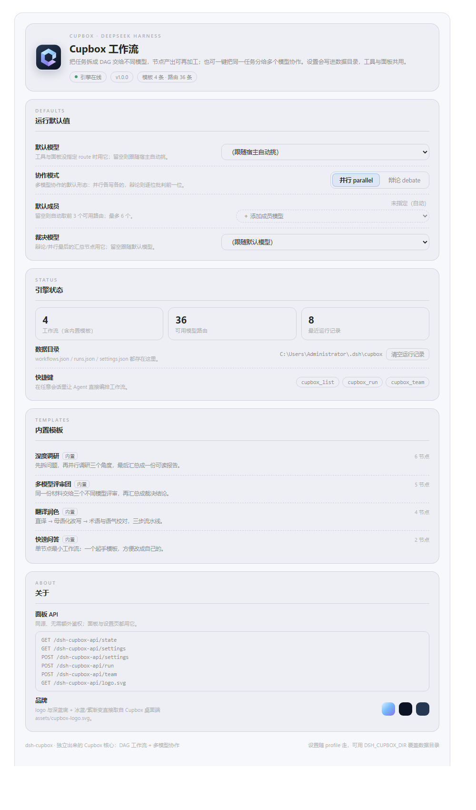

# dsh-cupbox

[](https://github.com/beizilaoshi/Cupbox-DSH-Test/releases)
[](https://github.com/beizilaoshi/Cupbox-DSH-Test/blob/main/LICENSE)

把 Cupbox 的核心能力（**DAG 工作流引擎 + 多模型协作**）从桌面应用里独立出来，做成一个 DeepSeek Harness 插件。没有 UI 框架依赖，宿主半边只用 `ctx.llm` / `ctx.tools` / `ctx.webServer`，客户端半边是一个独立的面板。

## 它提供什么



| 能力 | 入口 | 说明 |
| --- | --- | --- |
| 工作流引擎 | 工具 `cupbox_run` | 有向无环图：`start` / `model` / `js` / `join` 四类节点，按依赖分层并行执行，节点间用 `{{input}}`、`{{vars.x}}`、`{{nodes.<id>}}` 传递数据 |
| 多模型协作 | 工具 `cupbox_team` | `parallel`：同一任务分给多个模型再汇总裁决；`debate`：逐位批判性回应，最后裁决 |
| 模板与路由 | 工具 `cupbox_list` | 列出 4 条内置模板 + 当前宿主所有可用模型路由 |
| 可视化面板 | Web GUI | 会话顶部 `Cupbox` 页签（工作流 / 多模型协作 / 运行历史） |
| 设置页 | Web GUI | 设置 → **Cupbox 工作流**：沿用 Cupbox 的 logo 与品牌视觉，改默认模型、协作模式、成员与裁决模型，自动保存 |

内置模板：`research`（多角度检索综合）、`review-panel`（代码评审小组）、`translate-polish`（翻译 + 润色）、`quick-answer`（单节点快速问答）。

## 设置页

设置页读的是包内 `assets/cupbox-logo.svg`（与 Cupbox 桌面端 `desktop/ui/assets/cupbox-logo.svg` 同一份，深蓝底 + 冰蓝/紫渐变立方体），配色沿用 Cupbox 的视觉语言：圆角卡片、小字大写 eyebrow 分节、品牌渐变作为强调色。

| 配置项 | 默认 | 作用 |
| --- | --- | --- |
| 默认模型 | 跟随宿主自动挑 | 工具与面板没指定 `route` 时用它（工具参数仍优先） |
| 协作模式 | `parallel` | `cupbox_team` 不传 `mode` 时用它 |
| 默认成员 | 自动取前 3 个路由 | `cupbox_team` 不传 `models` 时用它，最多 6 个 |
| 裁决模型 | 跟随默认模型 | 协作里 brief / verdict 节点用它 |

改动即保存（`POST /settings`），写入数据目录的 `settings.json`，工具与面板共用；页面上还有引擎状态（工作流数 / 路由数 / 运行记录数）、内置模板清单与面板 API 一览。

## 安装

先克隆仓库，再在 DSH 里用插件管理器安装该目录：

```powershell
git clone https://github.com/beizilaoshi/Cupbox-DSH-Test.git E:/CupboxDSH
# 然后在 DSH 里
plugin_manager { action: 'install_bundle', target: 'file:E:/CupboxDSH' }
```

安装后三条工具立即生效；面板随页面刷新出现。**改动源码后必须重装**（`remove_bundle` 再 `install_bundle`），因为 profile 里是目录拷贝而不是软链接。

## 工作流定义格式

```json
{
  "id": "my-flow",
  "name": "我的流程",
  "nodes": [
    { "id": "start", "label": "输入", "kind": "start" },
    { "id": "a", "label": "角度 A", "kind": "model", "prompt": "从可维护性角度分析：\n\n{{input}}", "route": "deepseek-account/deepseek-flash" },
    { "id": "b", "label": "角度 B", "kind": "model", "prompt": "从性能角度分析：\n\n{{input}}" },
    { "id": "merge", "label": "汇总", "kind": "join", "from": ["a", "b"] },
    { "id": "out", "label": "裁决", "kind": "model", "prompt": "综合两份分析给出结论：\n\n{{nodes.merge}}" }
  ],
  "edges": [
    { "from": "start", "to": "a" },
    { "from": "start", "to": "b" },
    { "from": "a", "to": "merge" },
    { "from": "b", "to": "merge" },
    { "from": "merge", "to": "out" }
  ]
}
```

- `nodes[].route` 形如 `provider/model`；省略则用工具参数 `route`，再省略用宿主默认路由。
- `kind: "js"` 的节点写 `code`，可用变量：`$input`（上游产出）、`$nodes`（所有节点产出）、`$vars`（运行变量），`return` 的值即产出。
- `kind: "join"` 的 `from` 聚合多个上游，默认用分隔线拼接。
- 节点可加 `onError: "skip"`（失败即空产出，不中断整条流程）、`retry: 2`、`temperature`、`maxTokens`。

## 面板 API（同源 HTTP）

`/dsh-cupbox-api/*`（由 `webServer` 注册，仅本机可访问）：

| 方法 | 路径 | 作用 |
| --- | --- | --- |
| GET | `/state` | 工作流、最近运行、模型路由、设置、数据目录 |
| GET / POST | `/settings` | 读取 / 保存偏好（`{ settings: { defaultRoute, teamMode, teamMembers, judgeRoute } }`） |
| GET | `/logo.svg` | 设置页头部品牌 logo（`assets/cupbox-logo.svg`） |
| POST | `/run` | 运行工作流（`workflowId` 或 `definition`） |
| POST | `/team` | 多模型协作（`task` / `models` / `mode` / `judge`） |
| POST | `/save`、`/delete` | 保存 / 删除自定义工作流 |
| POST | `/runs/clear` | 清空运行历史 |

## 数据目录

`DSH_CUPBOX_DIR` → `DSH_PROFILE_DIR/cupbox` → `~/.dsh/cupbox`，里面是 `workflows.json`（自定义工作流）、`runs.json`（最多 40 条运行记录）与 `settings.json`（设置页偏好）。

## 开发

```powershell
node --check lib/index.js
node test/smoke.mjs            # 7 项离线测试：插值/校验/分层/并行/join/js/team/store
node test/render-settings.mjs  # 用最小 React 运行时渲染设置页并检查关键元素（需宿主在跑）
```

- 不要用 PowerShell 的 `Get-Content -Raw` + `Set-Content` 改含中文的源文件，会二次编码成乱码；用编辑器或 `write`/`edit` 工具。
- 宿主半边所有注册都包了 try/catch：`apply()` 永不抛错，单条路由或工具失败不影响其他功能。
- 模型调用一律走 `ctx.llm.stream(GenerateOptions)`，不自己拼 HTTP，凭据与计费由宿主管理。

## 目录

```
lib/engine.js           DAG 引擎：插值、分层、并行执行、JS 节点、多模型团队
lib/store.js            模板 + 用户工作流 + 运行历史 + 设置偏好（settings.json）
lib/index.js            宿主：工具、Web 路由、模型路由目录、logo
lib/client.js           客户端：Cupbox 会话面板 + Cupbox 风格设置页
assets/cupbox-logo.svg  品牌 logo（沿用 Cupbox 桌面端）
test/smoke.mjs          离线测试
test/render-settings.mjs 设置页渲染检查
```
